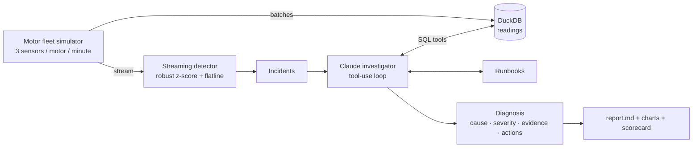

# edge-iot-anomaly-agent

[](https://github.com/harshithkonatham/edge-iot-anomaly-agent/actions/workflows/ci.yml)

Predictive maintenance for a fleet of industrial motors. A lightweight **streaming anomaly
detector** (small enough for an edge gateway) watches temperature, vibration and current;
every incident it raises is investigated by a **Claude agent** that queries the sensor
history in **DuckDB**, compares the motor with the rest of the fleet, reads the
**maintenance runbooks**, and returns a structured diagnosis an engineer can act on.

It combines my **BTech in Electronics & Communication** (sensors, signals, motors) with my
**MSc Data Science** modules in *Big Data Systems* and *Machine Learning Foundations*.

## How it works



1. **Simulate**: 6 motors stream readings every minute. Four realistic faults are injected
   at random times with known ground truth: bearing wear (vibration climbs), overheating
   (temperature and current climb), an intermittent electrical fault (current spikes) and a
   stuck sensor (one value repeated).
2. **Detect at the edge**: per motor and sensor, the detector learns a robust baseline
   (median and MAD) from the first hour, scores a smoothed value against it, flags stuck
   sensors, and groups nearby anomalies into incidents. Memory per stream is constant, so it
   can run on a gateway rather than in the cloud.
3. **Investigate with Claude**: for each incident, Claude (`claude-opus-5-5`, via the
   Anthropic SDK tool runner) uses five read-only tools:

   | Tool | What it gives Claude |
   |---|---|
   | `get_incident` | Device, time window, per-sensor anomaly summary |
   | `sensor_baseline` | The motor's normal level for a sensor |
   | `sensor_window` | Mean, max, trend per hour and distinct-value count (DuckDB SQL) |
   | `compare_with_fleet` | The same sensor on every motor, to tell one bad motor from a hot day |
   | `read_runbook` | Fault signature, severity thresholds and actions |

   It returns a `Diagnosis` validated against a Pydantic schema (structured outputs):
   likely cause, confidence, severity, evidence and recommended actions.
4. **Score**: incidents and diagnoses are compared with the injected faults: recall,
   precision, detection delay and diagnosis accuracy.

## Quick start

```bash
uv sync

# No API key needed: rule-based diagnosis
uv run iot-agent demo --offline

# With Claude investigating each incident
export ANTHROPIC_API_KEY=sk-ant-...
uv run iot-agent demo --effort medium --max-incidents 5
```

Options: `--devices`, `--hours`, `--seed`, `--db fleet.duckdb` (keep the data),
`--offline`, `--model`, `--effort`, `--max-incidents`, `--out`.

The report (`reports/report.md`) has a scorecard, each incident's diagnosis and evidence,
and a chart of all three sensors around the incident.

## Example scorecard (offline rules, seed 7)

| Motor | Injected fault | Incident | Delay (min) | Diagnosed as |
|---|---|---|---|---|
| motor-03 | bearing_wear | INC-003 | 49 | ✅ bearing_wear |
| motor-06 | sensor_dropout | INC-001 | 14 | ✅ sensor_fault |
| motor-02 | overheating | INC-002 | 33 | ✅ overheating |
| motor-04 | electrical_fault | INC-004 | 0 | ✅ electrical_fault |

Recall 100%, precision 100% (no false alarms) across seeds 3, 7, 11 and 42.

**Being honest about this result:** the simulated faults are clean and the rules were written
for them, so the rule-based baseline scores perfectly here. The agent earns its place on
cases that rules handle badly: fleet-wide changes (a hot day is not six overheating motors),
overlapping faults, and explaining *why* with evidence and runbook steps. Those scenarios
are the next thing to add to the simulator (see below).

## Design choices

- **Detection stays deterministic and cheap; the LLM only investigates.** Claude never sees
  the raw stream, only incidents, so cost scales with incidents, not readings.
- **Read-only tools and parameterised SQL.** The agent can query but not change data; tool
  inputs are validated (unknown motors, sensors or timestamps go back to Claude as errors).
- **Structured output.** Diagnoses are schema-validated, so they can feed a CMMS or ticketing
  system directly.
- **Refusal handling.** Server-side fallback (`fallbacks="default"`) plus an explicit check,
  and a cap on tool-loop iterations per incident.
- **Testable without an API key.** The agent is tested with a fake client that calls the
  real tools; CI runs the offline pipeline end to end.

## Development

```bash
uv run pytest --cov      # 19 tests, ~99% coverage
uv run ruff check . && uv run ruff format --check .
uv run bandit -q -r src -ll
```

CI (GitHub Actions): lint, tests with an 85% coverage gate, Bandit, pip-audit, Gitleaks,
then the offline demo with its report uploaded as a build artifact.

## Project layout

```
src/edge_iot_agent/
  simulator.py  Motor fleet + fault injection with ground truth
  detector.py   Streaming detector and incident grouping
  store.py      DuckDB storage and the SQL behind the agent's tools
  agent.py      Claude investigator (tool runner + structured output)
  rules.py      Rule-based diagnosis (offline baseline)
  pipeline.py   Stream → detect → store, and the scorer
  report.py     Markdown report and charts
  runbooks/     Maintenance runbooks the agent reads
```

## Next steps

- Harder scenarios: fleet-wide ambient heat, overlapping faults, slow sensor drift; compare
  agent vs rules on them
- Replace the in-process stream with **Kafka** or **MQTT** (the detector already consumes a
  plain iterator of readings)
- Expose the tools as an **MCP server** so any agent (or Claude Desktop) can investigate the fleet
- Run the detector on a Raspberry Pi as a real edge gateway
